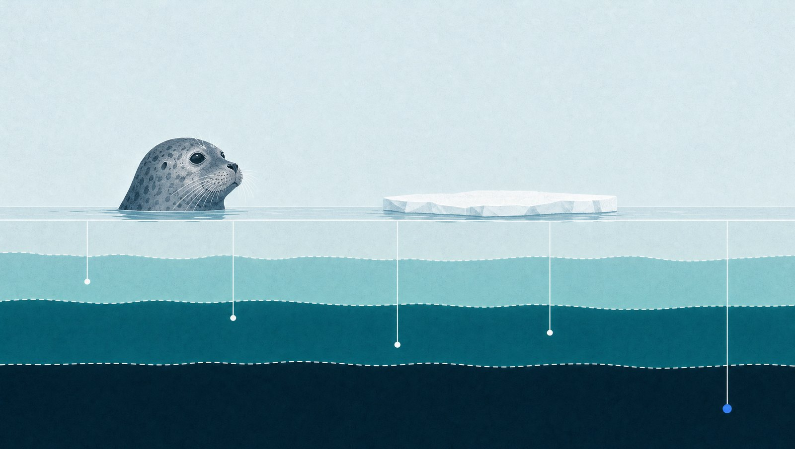

# WatchSeal: an upgrade watchdog that remembers how you triage

*Written for the Total Recall hackathon (Tatum x Walrus), November 2026.*



The [3-minute demo video](https://github.com/0xNoramiya/watchseal/releases/download/v0.1.0/watchseal-demo.mp4) shows everything below, recorded against Sui Mainnet. The code is at [github.com/0xNoramiya/watchseal](https://github.com/0xNoramiya/watchseal).

On 22 May 2025, the day of the Cetus exploit, the Cetus CLMM package on Sui was upgraded to v11. The ABI didn't change at all. Only the bytecode of one module, `config`, did. Most monitoring tools would say nothing happened. An analyst who knew the date would say something very much happened.

That gap is what WatchSeal is about. Detecting an upgrade is easy. Knowing which upgrades matter for a given protocol is judgment, and that judgment lives in an analyst's head. WatchSeal writes it down in Walrus Memory and uses it on the next alert.

## What it does

You add a Sui protocol by package id. For every upgrade, WatchSeal:

- diffs the Move ABI between the old and new version (new modules, new public and entry functions, widened visibility, new capability types),
- hashes every module's bytecode to catch changes that leave the ABI untouched,
- reads the upgrade transaction: who signed it, with which signature scheme, and where the UpgradeCap went,
- recalls what it has learned about this protocol from Walrus Memory,
- asks a Claude agent to rate the risk and explain which memories changed its mind.

Then you label the alert: expected, suspicious or a false positive. That label becomes a memory. So does a signer you approve, and so does any standing rule you type, like "always escalate new withdraw functions".

The dashboard has a "Compare without memory" button that re-runs the same alert with zero memories, and a depth gauge that shows both verdicts side by side. I wanted the learning to be something you can check, because an agent that claims to have learned is easy to build and hard to trust.

## How it uses Tatum

Sui's JSON-RPC is gone from Mainnet, so WatchSeal talks gRPC. Every live chain read goes through Tatum's Sui Mainnet gRPC gateway over native HTTP/2. `@grpc/grpc-js` and `@protobuf-ts/grpc-transport` are wired into `SuiGrpcClient` from `@mysten/sui`, with the API key in the `x-api-key` header.

The calls WatchSeal makes:

- `MovePackageService.ListPackageVersions` to find every version of a package,
- `MovePackageService.GetPackage` for the structured ABI (functions, visibility, parameters, datatypes and abilities),
- `LedgerService.GetObject` with a read mask for module bytecode, for the `previous_transaction` that published each version, and for the UpgradeCap's owner and policy,
- `LedgerService.GetTransaction` for the upgrade transaction's sender, signatures and changed objects.

Two practical lessons. First, the free tier rate-limits bursts, so every call goes through a small throttle with retry and backoff. Second, full nodes prune old transactions, and the 2025 Cetus upgrades come back `NOT_FOUND` over gRPC. WatchSeal falls back to the archival Sui GraphQL endpoint for those, and the UI says which source each transaction came from. The dashboard counts Tatum calls and archival calls separately.

## How it uses Walrus Memory

Each memory is one plain sentence behind a tag header:

```
[watchseal][protocol:cetus-clmm][kind:triage][label:false-positive][sig:bytecode-only,new-public-fn][mod:config,pool,...][v13]
Analyst marked Cetus CLMM v13 as a false positive: ... Treat similar changes as noise.
```

There are four kinds: baselines, known upgrade authorities, triage labels and standing rules. Writes go through `@mysten-incubation/memwal`. `remember` returns a job id right away, and the relayer embeds, encrypts with SEAL and uploads to Walrus in the background. The dashboard shows every write as pending until its blob id comes back. Before rating the next alert, WatchSeal waits for in-flight writes, so the label you just gave counts immediately.

For each alert it runs a handful of `recall` queries (the change itself, recent labels, standing rules, known authorities, the baseline), filters results by protocol tag, and hands the memories, with their ids, to Claude. Claude may only cite ids it was given, and the UI links every cited memory to its Walrus blob. The dashboard also reads the relayer's inventory for the namespace with `listMemories` and marks each memory it wrote as verified. That is how I know the 18 memories behind the demo video are really on Walrus, paid through epoch 58, and not just in my app's log.

A few rules keep memory honest:

- Known signers exist only in memory. Without memory, "this signer is new" cannot be said at all.
- A triage label never clears an identity signal. Saying "expected" about one upgrade must not quietly trust a different signer later; only an explicit authority memory does that.
- Only memories learned before the alerted version count, so replaying history never leaks the future.

## How it learned over time

The demo replays real Cetus CLMM history from v9, one upgrade at a time. This is the run in the video.

**v10** adds flash loans, and the upgrade is signed by a new multisig, `0xdbfd…`, with the UpgradeCap moved to it. Without memory, WatchSeal rates it high. With memory it is critical. The v9 authority memory names `0x2891…` as the known signer, so this one is new. I label it expected (it was a planned rotation), and WatchSeal stores `0xdbfd…` as a known authority.

**v11** is the exploit-day hotfix, a bytecode-only change in `config`. The signer is now known, and on code alone it is low risk. I label it suspicious anyway. Then I add a rule: always escalate new withdraw functions.

**v12** adds 38 functions, including `governance_fund_withdrawal` and `emergency_remove_malicious_position`. Without memory it is high. With memory it is critical, because the withdraw rule fired. I label it expected.

**v13** churns the bytecode of all 13 modules and adds `emergency_unpause`. My earlier "expected" labels on v10 and v12 pull it down to low. I label it a false positive, since it looks like dependency relink noise.

**v14** adds `create_pool_v3` and friends, with more bytecode churn, this time including `config`. Without memory it is high. With memory it is medium, and the memory influence panel shows three memories pulling in two directions. The v13 false-positive label and the v12 "expected" label pull it down. The v11 "suspicious" label I added on a hunch matches the `config` change and pulls it back up. That is the moment I trust most in the whole demo. A label from three upgrades earlier, with its reason attached, is still doing its job.

I ran the replay twice that day. In the first run Claude didn't weigh the v11 label, and v14 landed at low. In the recorded run it did, and v14 stopped at medium. The direction was the same both times; the exact level depends on how Claude weighs memories that disagree. That is why the panel cites every memory it used, with its blob id, instead of just printing a level.

Six upgrades in, WatchSeal has stopped shouting about the things I keep telling it are fine, and it still escalates the things I told it to watch. It is a little unsettling how quickly it adopts my judgment. That is why the guardrails above exist. It can learn my habits, but it can't learn to trust a signer I never approved.

## Drawing the learning

A table of verdicts proves the point and bores everyone. So the upgrade history is drawn as an echo-sounder paper recording, the strip charts survey ships printed for most of the last century. Depth runs down the paper and time runs along it. The dark bottom echo is each verdict with memory, so risk is literally depth. The verdict without memory is drawn as a fainter second echo, which is what a real sounder prints when the signal bounces twice. Memories that moved a verdict show up as small arches in the water column, the way fish do. Each version gets a fix mark with the analyst's label written in by hand.

The rules for that drawing came from research into how wet-paper and dry-paper recorders worked (one ink, a few grey steps, a band rather than a line), and the renderer is a pure function of a seeded config. In development there is a small lab at `/lab/echogram` with knobs for all of it; saving a config there is what changes the dashboard.

You can also ask the memory directly. "Who is allowed to upgrade Cetus?" runs a semantic recall against Walrus and returns the two signer memories first, at 66% and 65% similarity. "What did I call noise?" returns the v13 false-positive label. No keywords in common, which is the point of storing sentences instead of rows.

## Making memory visible in the score

My first scoring model was a weighted sum of signals. On a big release like v12 everything saturated at critical, so memory had nowhere to move the verdict. The fix was to cap each signal kind's contribution, cap the code-surface total just below critical, and reserve critical for authority anomalies or a matching analyst rule. The test suite now asserts that the verdict with memory differs from the verdict without it on the real v10 and v14 upgrades.

## What's next

- Push alerts for live mode (Slack, Telegram) instead of a dashboard you have to look at.
- Shared team memory: several analysts writing to one namespace, with the label author in the tag header.
- Upgrade policy diffs for packages that use custom upgrade policies instead of the default UpgradeCap.

The code is in this repository. `npm test` replays the Cetus history offline in about a second.
