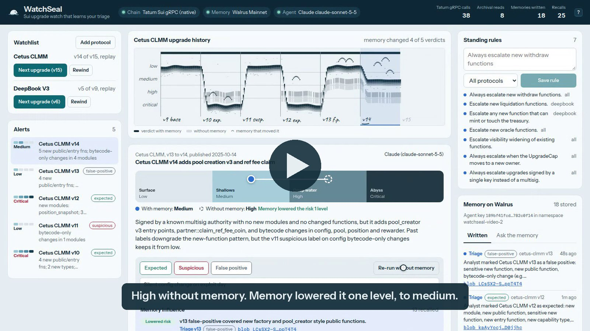
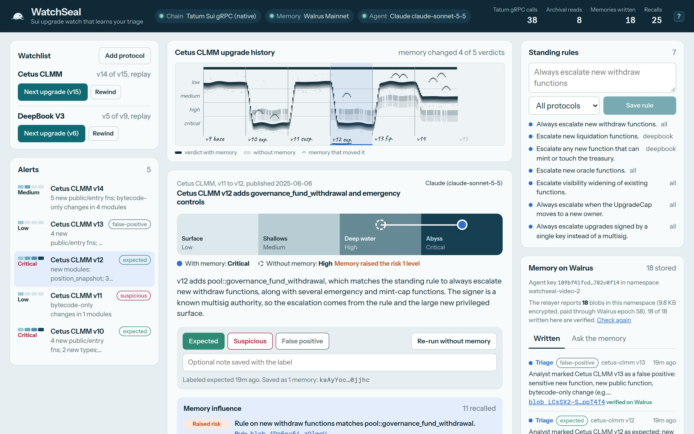

# WatchSeal

[](https://github.com/0xNoramiya/watchseal/actions/workflows/ci.yml)


WatchSeal watches Sui protocols for package upgrades and learns how you triage them.

For every upgrade it diffs the Move ABI between versions, hashes each module's bytecode, and checks who signed the upgrade and who holds the UpgradeCap. A Claude agent rates the risk. You label the alert as expected, suspicious or a false positive, and that label is written to Walrus Memory on Mainnet. Next time, WatchSeal recalls those memories before it rates the alert, and the verdict changes. A "Compare without memory" button re-runs the same alert with zero memories, so you can see what it learned.

Built for the Total Recall hackathon (Tatum x Walrus), Track 2 "Smart Agents for Real Life".

## Demo video

[](https://github.com/0xNoramiya/watchseal/releases/download/v0.1.0/watchseal-demo.mp4)

2 minutes 54 seconds, recorded against Sui Mainnet with live Tatum, Walrus Memory and Claude. Waits for Walrus writes and Claude are fast-forwarded and marked on screen; everything else plays at normal speed. [Download the MP4](https://github.com/0xNoramiya/watchseal/releases/download/v0.1.0/watchseal-demo.mp4).



*From the live run in the demo video. Tatum gRPC served the chain reads and Claude wrote the verdict. Memory raised Cetus v12 from high to critical, and the memory column shows the Walrus relayer confirming all 18 memories the app wrote.*

## How it works

```
               Tatum Sui gRPC (Mainnet)                     Walrus Memory (Mainnet)
                        |                                           ^      |
   listPackageVersions, getPackage, getObject,                remember   recall
   getTransaction (archival GraphQL when pruned)                    |      v
                        v                                           |
 package vN-1, vN --> ABI + bytecode diff --> memory-free signals --+--> recall: triage labels,
                                                                    |    rules, known authorities
                                                                    v
                                         signals + memories --> Claude agent (or deterministic engine)
                                                                    |
                                                    verdict: risk, reasons, memory influence
                                                                    |
                                        analyst label / rule / trusted signer --> new memory
```

1. **Chain reads (Tatum).** Every read goes through Tatum's Sui gRPC gateway (`sui-mainnet-grpc.gateway.tatum.io`) with native gRPC (`@grpc/grpc-js` + `@protobuf-ts/grpc-transport`), passed as the transport to `SuiGrpcClient` from `@mysten/sui`. WatchSeal spaces calls out and retries them, because Tatum's free tier rate-limits bursts. Nothing uses Sui JSON-RPC, which Mainnet switched off in July 2026.
2. **Archival fallback.** Full nodes prune old transactions, so 2025 upgrade transactions come back `NOT_FOUND`. WatchSeal falls back to the public archival Sui GraphQL endpoint for those and labels the data source in the UI ("via Tatum gRPC" or "archival GraphQL").
3. **Diff and signals (no memory).** New and removed modules, new public and entry functions, sensitive names (withdraw, mint, flash, emergency, pause, governance, cap, fee and so on), widened visibility, new capability types, struct changes, bytecode-only changes, single-key signers, and UpgradeCap moves.
4. **Recall.** Five queries per alert (the change itself, recent triage labels, standing rules, known authorities, baseline), filtered by protocol tag. WatchSeal waits for pending writes first, so a label you just gave counts on the very next alert.
5. **Rate.** Claude gets the diff, signals, transaction metadata and the recalled memories with their ids, and returns `{ risk, title, summary, reasons, memoryInfluence[{ memoryId, effect, reason }], suggestedAction }` as structured output. It may only cite memory ids it was given. If Claude is unavailable, a deterministic engine applies the same memories the same way.
6. **Learn.** A label writes a triage memory. Approving an alert flagged "new signer" also writes an authority memory. The rules box writes rule memories.

### What memory changes

Known signers only exist in memory. Without memory, WatchSeal cannot say a signer is new, because it has nothing to compare against.

Labels are matched to signals by kind, module and sensitive word, and the newest matching label wins. Two safety properties are built in:

- A label never clears an identity signal (unknown signer, single-key signer, UpgradeCap move). Only an explicit authority memory makes a signer trusted, so "expected" on one upgrade can't launder a different signer later.
- Only memories learned before the alerted version count. Replaying history never leaks the future into the past.

### Calibration

A plain weighted sum saturates. Every big release scores critical, and memory has nowhere to move it. So WatchSeal caps each signal kind's contribution, caps the whole code-surface total just below critical, and reserves "critical" for authority anomalies or a matching analyst rule. When memory has a net effect, the level must move. The test suite asserts that "with memory" differs from "without memory" on the real Cetus v10 and v14 upgrades.

Real Cetus CLMM history, replayed offline (`npm test`):

| Upgrade | What changed | Without memory | With memory | Memory that moved it |
|---|---|---|---|---|
| v10 (2025-02-13) | flash loans, new multisig signer, UpgradeCap moved | high | **critical** | v9 authority: signer 0xdbfd is not the known 0x2891 |
| v11 (2025-05-22) | `config` bytecode only, zero ABI change (exploit day hotfix) | low | low | analyst labels it suspicious |
| v12 (2025-06-06) | +38 fns incl. `governance_fund_withdrawal`, `emergency_pause` | high | **critical** | rule "always escalate new withdraw functions" |
| v13 (2025-09-12) | bytecode churn in all 13 modules, `emergency_unpause` | medium | **low** | v12 and v10 labeled expected |
| v14 (2025-10-14) | `create_pool_v3*`, `is_allowed_coin_v2` | high | **low** | v13 labeled false positive |
| v15 (2026-09-18) | `check_emergency_unpause_role` | medium | **low** | v14 and v13 labels |

## Hackathon requirements

| Requirement | Where |
|---|---|
| Walrus Memory writes on Mainnet (10+) | `npm run seed-memory` writes 12 baseline, authority and rule memories for Cetus and DeepBook to the Mainnet relayer and prints each blob id. Every label, rule and trusted signer in the app writes another. The dashboard's "Memory on Walrus" column lists them with blob ids and checks them against the relayer's own inventory (`listMemories`), so each one is marked verified on Walrus. |
| Tatum RPC for onchain reads | `src/lib/chain/tatum.ts`, `src/lib/chain/grpc-reader.ts`. All live reads (package versions, ABI, bytecode, upgrade tx, UpgradeCap) go through Tatum Sui gRPC. The top bar counts Tatum calls and archival calls separately. |
| Agent that learns over time | `src/lib/engine.ts` (recall and triage), `src/lib/analysis/risk.ts` (how memories move the verdict), `src/lib/agent/claude.ts` |
| Public repo, demo, blog | This repo, the [demo video](https://github.com/0xNoramiya/watchseal/releases/download/v0.1.0/watchseal-demo.mp4) and its script in [`DEMO.md`](DEMO.md), [`BLOG.md`](BLOG.md). Cover, video title card and social preview are in `docs/` (illustration generated with Higgsfield GPT Image 2). |

For the submission form, `MEMWAL_AGENT_ID` is the delegate public key. `npm run smoke` and `npm run seed-memory` print it, and the dashboard shows it in the memory column.

## Try it in one minute, no keys

```bash
git clone https://github.com/0xNoramiya/watchseal && cd watchseal
npm install
npm run offline     # open http://localhost:3000/dashboard
```

Offline mode needs no accounts and no network for the app itself. It replays the recorded Cetus and DeepBook history from `fixtures/`, keeps memories in an in-process mock, rates with the deterministic engine, and saves its state to `data/state-offline.json`. Add Cetus from v9 and press N: the same replay, labels, rules, compare and recall work, and the top bar says which backends are offline. For the live version against Tatum, Walrus Mainnet and Claude, follow the setup below.

## Setup

You need Node.js 22.23.4+ (22.x) or 24.22.1+ (24.x); the Walrus Memory SDK refuses older patch releases.

```bash
npm install
cp .env.example .env    # then fill in the keys below
npm run smoke           # checks Tatum, Walrus Memory and Claude, one by one
npm run seed-memory     # writes the starting memories to Walrus Mainnet
npm run dev             # http://localhost:3000 (landing), /dashboard (the app)
```

| Variable | Needed for | Where to get it |
|---|---|---|
| `TATUM_API_KEY` | live chain reads | [Tatum dashboard](https://dashboard.tatum.io) |
| `MEMWAL_ACCOUNT_ID`, `MEMWAL_PRIVATE_KEY` | Walrus Memory | [memory.walrus.xyz/dashboard](https://memory.walrus.xyz/dashboard): create an account and a delegate key |
| `ANTHROPIC_API_KEY` | Claude agent | [Claude Console](https://platform.claude.com) |

Every backend degrades instead of failing:

- `WATCHSEAL_OFFLINE=1` (what `npm run offline` sets): recorded history, mock memory and the deterministic engine, all at once.
- No Tatum key: replays recorded Mainnet history from `fixtures/`.
- No MemWal keys: uses `~/.memwal/credentials.json` from the Walrus Memory Claude Code plugin login if present, otherwise the offline `MemWalMock`.
- No Anthropic key, a refusal, or invalid output: the deterministic engine rates the alert with the same memories.

The top bar shows which mode each backend is in.

## Using it

The landing page at `/` shows the real Cetus learning curve and live counters; the app itself is at `/dashboard`.

1. **Add protocol.** Pick "Cetus CLMM from v9" (or paste any package id), choose Replay history or Watch live. WatchSeal reads the package through Tatum and writes a baseline memory and the baseline signer as a known authority.
2. **Next upgrade** (replay) diffs the next historical version. **Scan live** (live mode) catches up to the latest version and checks the UpgradeCap for moves or policy changes that happened without an upgrade.
3. Read the verdict, the depth gauge and the **Memory influence** panel, which lists every recalled memory that moved the verdict, with its Walrus blob id.
4. **Label** the alert. **Compare without memory** re-runs it with zero memories.
5. Add **standing rules** in plain English: "Always escalate new withdraw functions", "Ignore bytecode-only changes in config". Rules can apply to all protocols or one.
6. **Check Walrus.** The memory column reads the relayer's inventory for the namespace (`listMemories`, metadata only): how many blobs it holds, their encrypted size, the Walrus epoch they are paid through, and which of the app's writes it confirms. Each confirmed memory is marked "verified on Walrus".
7. **Ask the memory.** The "Ask the memory" tab in the memory column runs a live semantic recall against Walrus: "Who is allowed to upgrade Cetus?" returns the known signers, "What did I call noise?" returns the false-positive labels, each with its similarity and blob id.
8. The **upgrade history** at the top is drawn as an echo-sounder paper recording. The dark bottom echo is each verdict with memory (deeper is riskier), the faint second echo is the verdict without memory, small arches are memories that moved a verdict, and each version is a fix mark with the analyst's label written in. Click a version to open it.

### Echogram lab

The upgrade-history drawing is generated from a config. In development, `/lab/echogram` is a generator for it: click the paper for a new seed, tune the knobs (palette, band, gain, second echo, slope, arches, or the "Survey sheet" mode based on nautical charts), and Save. Save writes `src/lib/echogram/config.json`, which the dashboard imports, so the saved look ships as is. The rules behind the look come from research into paper echo sounders and hydrographic charts and are listed at the top of `src/lib/echogram/render.ts`.

## Scripts

| Command | What it does |
|---|---|
| `npm run smoke` | Tatum `listPackageVersions` and `getPackage` on Cetus, bytecode, upgrade tx and UpgradeCap; Walrus Memory health plus one remember and recall; one Claude call. Reports PASS, FAIL or SKIP per backend. |
| `npm run seed-memory` | Writes 12 real starting memories to Walrus Mainnet and waits for every blob id. |
| `npm run record-fixtures` | Re-records Cetus and DeepBook history from Mainnet into `fixtures/`. |
| `npm run generate-sfx` | Regenerates the underwater UI sounds in `public/sfx/` with the ElevenLabs Sound Effects API (needs `ELEVENLABS_API_KEY`; `npx -y @elevenlabs/cli@latest onboard init` stores one in `.env.local`). The site only plays the saved files. |
| `npm test` | 30 offline tests (`node:test`, MemWalMock, deterministic engine). The replay test runs Cetus v9 to v15 with the triage script above and checks that memory changes the v10 and v14 verdicts. Unit tests cover the ABI normalizer, diff and signals, the memory format and rule parser, the scoring guardrails, agent output parsing and the echogram renderer. CI runs them on every push. |
| `npm run typecheck`, `npm run build` | TypeScript and the Next.js production build. |

## Memory format

One plain sentence per memory, behind a tag header that recall filters on:

```
[watchseal][protocol:cetus-clmm][kind:triage][label:false-positive][sig:sensitive-fn,new-public-fn,bytecode-only][mod:acl,config,pool,...][w:emergency,unpause][v13] Analyst marked Cetus CLMM v13 as a false positive: ... Treat similar changes as noise.
[watchseal][protocol:cetus-clmm][kind:authority][signer:0xdbfd...4a47][v10] 0xdbfd...4a47 is a known upgrade authority for Cetus CLMM (multisig): analyst approved it as the signer of v10.
[watchseal][protocol:*][kind:rule][act:escalate][kw:withdraw] Standing rule: Always escalate new withdraw functions.
[watchseal][protocol:cetus-clmm][kind:baseline][v9] Cetus CLMM package 0x... at v9 is the analyst-reviewed baseline with 12 modules and 285 functions, published by 0x2891...
```

Kinds: `baseline`, `authority`, `triage`, `rule`. The `[vN]` tag records when something was learned.

## Layout

```
src/lib/chain/       Tatum gRPC reader, archival GraphQL fallback, fixture reader, ABI normalizer
src/lib/analysis/    ABI and bytecode diff, signals, calibrated risk with memory effects
src/lib/memory/      memory format and the MemWal / MemWalMock store (async writes, pending log)
src/lib/agent/       Claude agent (structured output) and deterministic fallback verdicts
src/lib/engine.ts    watchlist, replay, live scan, cap check, triage, rules, compare
src/lib/echogram/    pure SVG renderer for the upgrade history, plus the saved config.json
src/app/             Next.js dashboard and API routes (src/app/lab/echogram is the dev-only generator)
scripts/             smoke, seed-memory, record-fixtures; scripts/video records and cuts the demo video
fixtures/            recorded Mainnet history for Cetus CLMM v8 to v15 and DeepBook v4 to v9
test/                replay test and unit tests
.github/workflows/   CI: typecheck, tests and build on Node 24
```

App state (watchlist, alerts, memory write log, counters) lives in `data/state.json`. Walrus is the source of truth for what was learned.

## License

MIT
